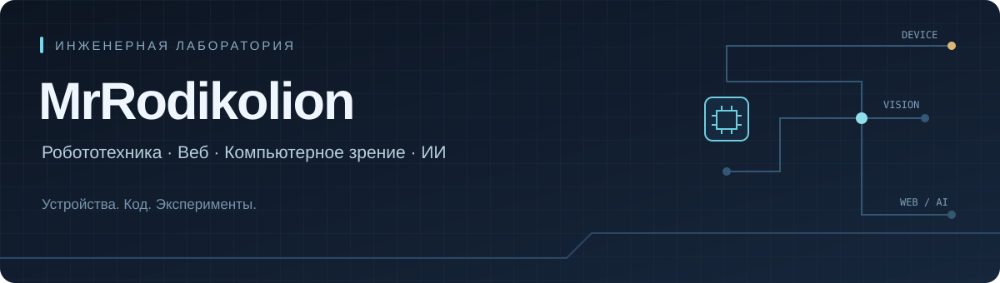
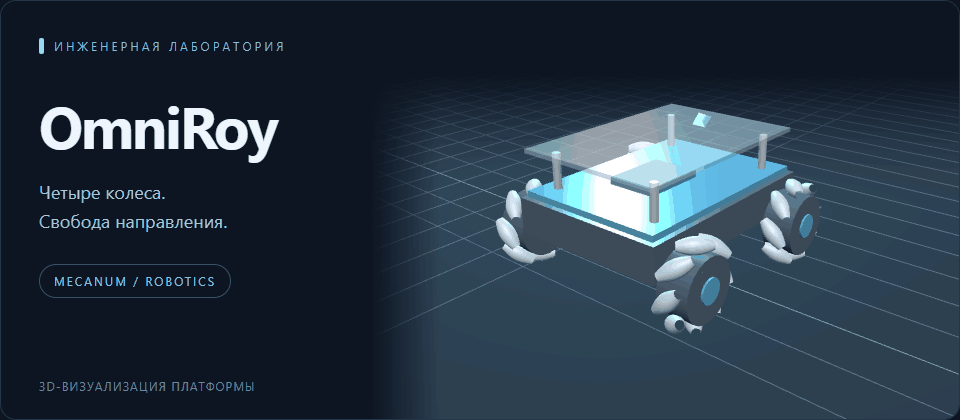

[Проекты](#избранные-проекты) · [Направления](#чем-занимаюсь) · [Технологии](#технологии-в-проектах)

## Привет, я MrRodikolion

Занимаюсь робототехникой и программированием. В моих проектах — устройства на
микроконтроллерах, веб-приложения, компьютерное зрение и инструменты подготовки
данных для ИИ.

Мне интересен путь от идеи и алгоритма до работающей программы или устройства.

## Чем занимаюсь

| Направление | Что можно найти в репозиториях |
|---|---|
| **Робототехника** | Мобильные платформы, следование по линии, прошивки и обмен командами |
| **Веб-разработка** | Flask-приложения, проекты с базами данных и работа с изображениями |
| **Компьютерное зрение** | Обработка кадров, поиск линии и эксперименты с распознаванием объектов |
| **ИИ и данные** | Подготовка датасетов, аугментации и синтетические изображения |

## Избранные проекты

*OmniRoy — стилизованная 3D-визуализация платформы с четырьмя mecanum-колёсами.*

| Проект | Идея | Технологии |
|---|---|---|
| [**OmniRoy**](https://github.com/MrRodikolion/OmniRoy) | Четырёхколёсная mecanum-платформа и основа бортового контроллера | C++ · Java · Arduino |
| [**mahina**](https://github.com/MrRodikolion/mahina) | Машинка с QTR-линейкой, PID и приёмом сигнала светофора | ESP32 · FreeRTOS |
| [**autocar_**](https://github.com/MrRodikolion/autocar_) | Эксперименты с дорожной линией и распознаванием знаков | Python · OpenCV · PyTorch |
| [**NeuralNetwork Builder**](https://github.com/MrRodikolion/NeuralNetwork_builder) | Веб-менеджер изображений, аугментаций и экспорта датасетов | Flask · SQLAlchemy · Pillow |
| [**Datagen**](https://github.com/MrRodikolion/datagen) | Генератор синтетических изображений с YOLO-разметкой | Python · Flask · Selenium |
| [**Arduino Matrix**](https://github.com/MrRodikolion/forArduinoMatrix) | Матрица 10 × 10: рисунки, эквалайзер и режим Spotify | Arduino · FastLED · PyQt |

Часть проектов — аппаратные и исследовательские прототипы. Возможности,
инструкции запуска и ограничения описаны в README каждого репозитория.

## Технологии в проектах

**Языки:** Python · C++ · Java  
**Устройства:** Arduino · ESP32 · ESP8266 · PlatformIO · FreeRTOS  
**Веб и данные:** Flask · SQLAlchemy · SQLite  
**Изображения и модели:** OpenCV · PyTorch · Pillow · NumPy

## Ещё несколько экспериментов

[**svet** — сеть учебных светофоров](https://github.com/MrRodikolion/svet) ·
[**pygame_proj** — платформер с фонарём](https://github.com/MrRodikolion/pygame_proj) ·
[**Console Delivery** — консольная служба доставки](https://github.com/MrRodikolion/lab1-Console-Delivery)
